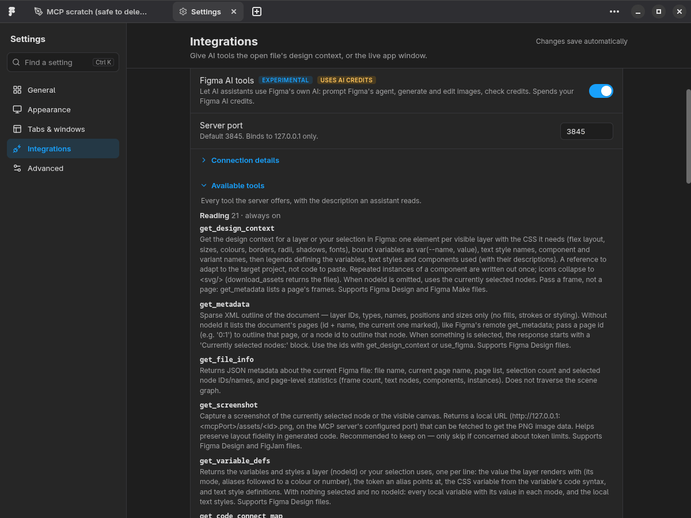

#  Figma Linux Next

Desktop client for [Figma](https://figma.com) on Linux, built on [Electron](https://www.electronjs.org).
Loads `figma.com` directly — no private APIs, no data scraping, no account sharing.
Not affiliated with or endorsed by Figma, Inc.

<p>
  <a href="https://github.com/arximus88/figma-linux-next/releases"></a>
  <a href="https://github.com/arximus88/figma-linux-next/releases"></a>
  <a href="https://github.com/arximus88/figma-linux-next/actions/workflows/ci.yml"></a>
  <a href="LICENSE"></a>
  <a href="https://github.com/arximus88/figma-linux-next/stargazers"></a>
  <a href="https://aur.archlinux.org/packages/figma-linux-next"></a>
  <a href="https://aur.archlinux.org/packages/figma-linux-next-bin"></a>
</p>

> **🧪 Status: Active Testing** · [Install](#installation) · [Features](#features) · [AI / MCP](#ai-integration-mcp) · [Browser Links](#opening-links-from-your-browser) · [Releases](https://github.com/arximus88/figma-linux-next/releases)

## Features

- **Local system fonts** — full `fontconfig` (`fc-list`) enumeration plus `fontkit` for variable-font axes and named instances, matching the official desktop app.
- **Built-in MCP server for AI assistants** — live [Model Context Protocol](https://modelcontextprotocol.io) server (`127.0.0.1:3845` by default) that speaks the same tool calls as Figma's remote MCP, so Claude Code, Cursor and other clients can read and edit your open design without a plugin. See [AI integration (MCP)](#ai-integration-mcp).
- **Local plugin development** — import a plugin from its `manifest.json` and iterate locally with hot-reload.
- **Figma links open in the app** — answers Figma's browser probe so **Open in desktop app** and **Open links in desktop app** work on Linux just like on macOS and Windows. See [Opening links from your browser](#opening-links-from-your-browser).
- **Shader, Halftone & Noise effects** — supports Figma's WebGPU canvas effects (Experimental, opt-in in Settings). NVIDIA-only systems with driver 535.183.01 or newer keep native Wayland; elsewhere the app runs under X11/XWayland while it is enabled.
- **Native Wayland & X11** — runs natively on GNOME, KDE Plasma, Sway, Hyprland, and Niri with a clean X11 fallback. Tested on x64 and arm64 (including Asahi Linux).
- **Desktop-native window frames & tabs** — auto-selects GNOME (Adwaita), KDE Plasma (Breeze), or Legacy Windows chrome with Light/Dark/System themes, optional hidden min/max buttons, configurable `+` tab button position, and tab hover preview cards.
- **Instant new-file tab** — pre-loaded in the background after login so new tabs open without delay.
- **System tray & config isolation** — optional tray mode (native on KDE Plasma, AppIndicator on GNOME) and isolated settings in `~/.config/figma-linux-next`.
- **Latest Chromium & Google Fonts** — powered by Electron 45 (Chromium 156) with up-to-date Google Sans, Google Sans Flex, and Google Sans Code.

## Installation

### Flatpak (Recommended — auto-updates)

One click: open **https://arximus88.github.io/figma-linux-next/** and use the install button (GNOME Software and KDE Discover handle `.flatpakref` files directly). Or from the terminal:

```bash
flatpak install --user https://arximus88.github.io/figma-linux-next/figma-linux-next.flatpakref
```

This adds the project's signed Flatpak repository, so updates arrive via `flatpak update` and your software center. (The standalone `.flatpak` bundle on the Releases page also works, but does not auto-update.)

### AUR (Arch / CachyOS)

```bash
yay -S figma-linux-next
# or prebuilt binary:
yay -S figma-linux-next-bin
```

Packages: [figma-linux-next](https://aur.archlinux.org/packages/figma-linux-next) · [figma-linux-next-bin](https://aur.archlinux.org/packages/figma-linux-next-bin)

### Packages & AppImage (`.deb`, `.rpm`, `.pacman`, `.AppImage`)

Download from **[GitHub Releases](https://github.com/arximus88/figma-linux-next/releases)** (x64 and arm64):

```bash
# Debian / Ubuntu (x64 or arm64)
sudo dpkg -i figma-linux-next_*_amd64.deb
# or: sudo dpkg -i figma-linux-next_*_arm64.deb

# Fedora / openSUSE
sudo rpm -i figma-linux-next_*_x86_64.rpm

# Arch / CachyOS (x64)
sudo pacman -U figma-linux-next_*_linux_x64.pacman

# AppImage
chmod +x figma-linux-next_*.AppImage && ./figma-linux-next_*.AppImage
```

> **AppImage login note:** On first launch the app automatically creates `~/.local/share/applications/figma-linux-next-appimage.desktop` and registers the `figma://` URL handler required for login. If browser login does not redirect back to the app, run once:
>
> ```bash
> xdg-mime default figma-linux-next-appimage.desktop x-scheme-handler/figma
> update-desktop-database ~/.local/share/applications/
> ```

### NixOS

**User profile** (no system rebuild; omit `--extra-experimental-features` if flakes are already enabled):

```bash
nix profile add --extra-experimental-features "nix-command flakes" github:arximus88/figma-linux-next
xdg-mime default figma-linux-next.desktop x-scheme-handler/figma
```

Log in from Firefox or a Chromium-based browser (GNOME Web / Epiphany does not pass `figma://` links to the app). Update later with `nix profile upgrade figma-linux-next`.

**Declarative (NixOS module)** — installs the package and registers the `figma://` handler automatically:

```nix
inputs.figma-linux-next.url = "github:arximus88/figma-linux-next";

# in your nixosConfiguration:
imports = [ figma-linux-next.nixosModules.default ];
programs.figma-linux-next.enable = true;
```

The flake ships prebuilt release binaries (`x86_64` and `aarch64`) updated by CI on each release, or you can pin a tag (`github:arximus88/figma-linux-next/vX.Y.Z`).

## AI integration (MCP)

`figma-linux-next` ships a built-in [Model Context Protocol](https://modelcontextprotocol.io) server so assistants like Claude Code can work with your **live** design — no plugin to install, no cloud round-trip. Everything binds to `127.0.0.1` and is configured in **Settings → Integrations**.

- **Context that fits your agent.** `get_design_context` answers in markup with CSS: tokens by name (`var(--color-text, #14191f)`), text styles and component docs defined once, repeated instances written out once. A 54-layer screen takes 10k characters where raw JSON took 95k. Pass `clientFrameworks: "react"` and it answers with a React + Tailwind component instead, like Figma's remote server.
- **Speaks Figma's remote MCP.** `use_figma` runs Plugin API code as one undo step, every file tool takes a `fileKey` or a pasted link and runs in that file's tab, plus `get_metadata`, `get_screenshot`, `get_motion_context`, `get_variable_defs`, `search_design_system`, `download_assets` / `upload_assets`, `get_comments` and `get_versions`.
- **Stays out of your way.** A file named by `fileKey` does not have to be the tab in front, or even loaded: tools read it, screenshot it and edit it in the background, and never raise the window or switch your tab.
- **Your whole design system in reach.** Search every team and community library you can use, list libraries and their published styles, see library updates the file has not accepted, read Code Connect snippets.
- **Figma's AI, from your own assistant** (experimental, off by default, spends your AI credits). Claude or Cursor can hand a task to Figma's built-in agent and check what it changed, generate and edit images (saved to disk and placed in the file), and check your credit balance.
- **Control plane — Chrome DevTools (CDP)** (opt-in, needs a restart). Exposes the app window over `--remote-debugging-port` so a CDP client (e.g. [chrome-devtools-mcp](https://github.com/ChromeDevTools/chrome-devtools-mcp)) can drive the UI — switch tabs, click, type, screenshot the real window.

Reading is on out of the box. Write tools, Figma AI tools and window control are separate opt-in switches. Settings lists every tool with the description your assistant reads:



> **Edit permissions required:** The data plane uses Figma's Plugin API (`window.figma`), which Figma exposes only when you can **edit** the file (not with a View/Dev seat, "can view" links, Sites files, or when org plugins are disabled). When a tool can't read a file, it reports which limitation applies. For view-only files, use [Figma's remote MCP server](https://help.figma.com/hc/en-us/articles/32132100833559).

## Opening links from your browser

On macOS and Windows, Figma in a browser offers **Open in desktop app** and an **Open links in desktop app** preference by probing a local helper at `127.0.0.1:44950`. `figma-linux-next` answers that same probe on Linux (off by default; enable in **Settings → Integrations → Open links from your browser**).

1. Sign in to the same Figma account in both the browser and the desktop app.
2. Open any file on `figma.com` in Chrome or Firefox and select **Main menu → Preferences → Open links in desktop app** (or **Open in desktop app** for a one-off handoff).
3. On Chrome 142+, allow the *local network access* prompt for `figma.com` on first use (the first link stays in the browser; subsequent links open in the app).

If you use [figma-agent-linux](https://github.com/neetly/figma-agent-linux) for local fonts in the browser, keep this toggle off — both use port `44950`. Direct `figma://` links always open the app regardless of this setting.

## Migration from legacy figma-linux

Settings are stored in `~/.config/figma-linux-next`. To carry over settings from an older `figma-linux` installation:

```bash
cp ~/.config/figma-linux/settings.json ~/.config/figma-linux-next/
```

## Building from source

Built with **Electron 45** (Chromium 156), **Svelte 5** (runes), **Vite 8**, **Bun**, and **Biome**.

```bash
git clone https://github.com/arximus88/figma-linux-next.git
cd figma-linux-next
bun install
bun run dev      # dev mode with HMR
bun run build    # production build
bun run start    # run production build
bun run pack     # build all packages
```

## Issues & Discussions

- [Issues](https://github.com/arximus88/figma-linux-next/issues)
- [Discussions](https://github.com/arximus88/figma-linux-next/discussions)

## License

GPL-2.0-only — see [LICENSE](LICENSE).
